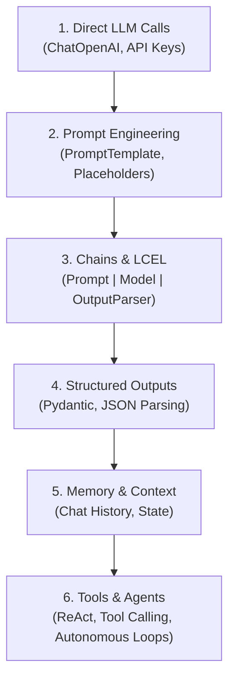

# 🧠 LangChain AI & LLM Application Blueprint

A foundational, step-by-step roadmap and template designed for developers starting their journey into Large Language Models (LLMs), LangChain, and AI Agent development.

---

## 🗺️ Developer Roadmap: From Prompt to Autonomous Agent

This repository serves as a progression guide through the essential milestones of building modern LLM applications:



---

## 📂 Project Architecture

```text
Langchain_Agent_SetUp/
├── .env                  # Environment secrets (API keys - NEVER commit to git)
├── .gitignore            # Ignores .venv, .env, __pycache__, etc.
├── requirements.txt      # Dependency specification
├── main.py               # Main application entry point (orchestrator)
├── module/
│   └── base.py           # Core model instantiations & configurations
└── README.md             # Foundational documentation & roadmap
```

---

## 🚀 Step-by-Step Setup Guide

### 1. Clone & Create Virtual Environment
```bash
# Clone the repository
git clone https://github.com/Shotza247/Langchain_Agent_Udemy.git
cd Langchain_Agent_Udemy

# Create a virtual environment
python -m venv .venv

# Activate virtual environment
# Windows (PowerShell):
.venv\Scripts\Activate.ps1
# macOS / Linux:
source .venv/bin/activate
```

### 2. Install Required Dependencies
```bash
pip install -r requirements.txt
```

### 3. Configure API Secrets
Create a `.env` file in the project root:
```env
OPENAI_API_KEY=your_openai_api_key_here
```

### 4. Run the Entry Point
```bash
python main.py
```

---

## 📚 Core Concepts & Milestones

### Milestone 1: Model Configuration & Initialization
Models are configured modularly in [`module/base.py`](module/base.py) to separate configuration from application logic:

```python
from langchain_openai import ChatOpenAI

def get_llm():
    return ChatOpenAI(
        model="gpt-4o-mini",
        temperature=0.9,
        max_completion_tokens=150
    )
```

**Key Parameters:**
- `model`: Target LLM (`gpt-4o-mini` for speed & efficiency, `gpt-4o` for complex multimodal tasks).
- `temperature`: Creativity control from `0.0` (deterministic, factual) to `1.0+` (creative, varied).
- `max_completion_tokens`: Output length ceiling to manage latency and cost.

---

### Milestone 2: Dynamic Prompt Templates
Instead of hardcoding prompt strings, use `PromptTemplate` with variables:

```python
from langchain_core.prompts import PromptTemplate

prompt_template = PromptTemplate.from_template(
    "What would a good company name be for a {name} company that sells {product}?"
)

prompt = prompt_template.format(name="Investment", product="Trading Charts")
```

---

### Milestone 3: LangChain Expression Language (LCEL)
Connect prompts, models, and parsers declaratively using the pipe (`|`) operator:

```python
from langchain_core.output_parsers import StrOutputParser

# Build a readable, composable pipeline
chain = prompt_template | llm | StrOutputParser()

# Invoke with dictionary inputs
result = chain.invoke({"name": "Investment", "product": "Trading Charts"})
print(result)
```

---

### Milestone 4: Tools & Agents (Next Steps)
Equip your model with external tools (web search, calculators, database lookups) and let the LLM decide which tool to use dynamically to solve multi-step problems.

---

## 🛡️ Best Practices for AI Engineering

1. **Keep Secrets Out of Version Control**: Always list `.env` inside `.gitignore`.
2. **Separate Modules**: Keep model configurations, prompts, and business logic decoupled.
3. **Use Output Parsers**: Ensure LLM responses are parsed into clean strings or typed Pydantic models.
4. **Clean Git Hygiene**: Use `git pull --rebase` to avoid cluttered merge commits and keep history linear.
